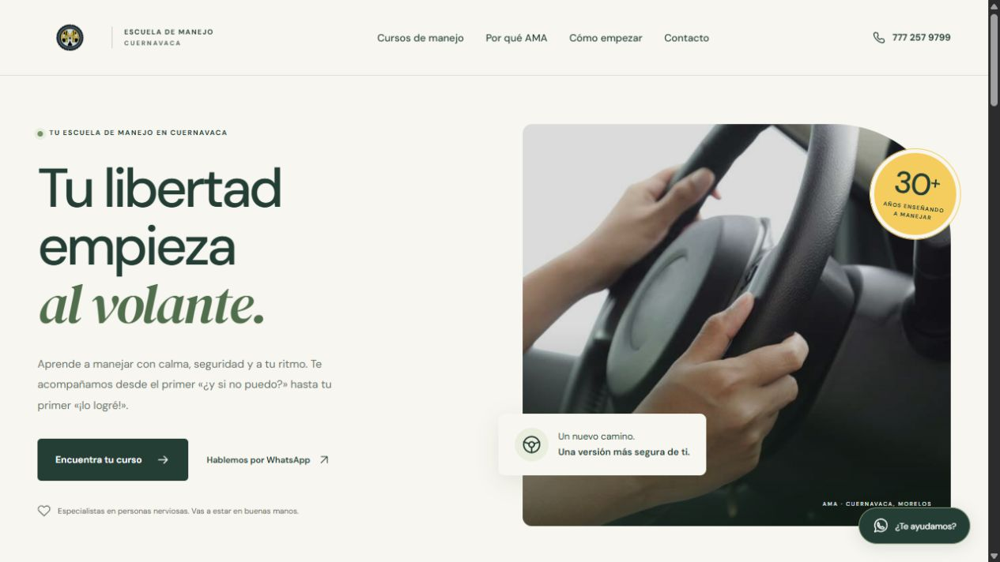

# AMA Cuernavaca · Propuesta 01

Primera propuesta local de diseño y navegación para la [escuela de manejo AMA](https://www.amacuernavaca.com/), revisada el 12 de noviembre de 2026.

Repositorio: [xisver/ama-cuernavaca](https://github.com/xisver/ama-cuernavaca).

La experiencia prioriza elegir un curso y contactar a la escuela. Conserva el logotipo y las fotografías del sitio de referencia y presenta una dirección visual en crema, verde oscuro y amarillo.



## Ejecutar localmente

Requisitos recomendados: Node.js 24 y npm.

```powershell
npm ci
npm run dev
```

Abre [http://127.0.0.1:3000/ama-cuernavaca/](http://127.0.0.1:3000/ama-cuernavaca/). El servidor funciona mientras la terminal permanezca abierta; `Ctrl+C` lo detiene.

Para generar y revisar la versión de producción:

```powershell
npm run build
npm run preview
```

La compilación se escribe en `dist/`. `preview` sirve esa compilación en la dirección que imprime Vite; no publica el sitio en Internet.

## Publicar en GitHub Pages

La configuración está preparada en `vite.config.js` y `.github/workflows/deploy.yml`. En GitHub, abre **Settings → Pages → Build and deployment → Source** y selecciona **GitHub Actions**. Después sube los cambios a `main`; el workflow compilará `dist/` y lo publicará. Los siguientes pushes a `main` actualizarán el sitio.

URL prevista: [https://xisver.github.io/ama-cuernavaca/](https://xisver.github.io/ama-cuernavaca/).

Consulta los pasos completos y la solución de errores en [docs/DEPLOY_GITHUB_PAGES.md](docs/DEPLOY_GITHUB_PAGES.md). Esta preparación local no activa ni ejecuta un despliegue remoto.

## Qué incluye

- Navegación fija por secciones, menú móvil e indicador de sección activa.
- Cursos básico, intensivo y de perfeccionamiento con selector de auto estándar o automático.
- Orientación de curso según experiencia y disponibilidad, sin guardar datos.
- Enlaces de WhatsApp con un mensaje específico para cada curso o servicio.
- Preguntas desplegables, teléfono, correo, ubicación y horarios.
- Fuentes DM Sans y DM Serif Display incluidas mediante paquetes locales; iconos SVG propios.
- Diseño adaptable, enlace para saltar al contenido, foco visible y respeto por la preferencia de movimiento reducido.

## Estructura

```text
index.html             Documento, metadatos y punto de entrada
src/main.js            Interfaz e interacciones
src/data.js            Cursos, preguntas y datos de contacto
src/icons.js           Iconos SVG
src/styles.css         Estilos principales
src/responsive.css     Adaptaciones para pantallas pequeñas
public/images/         Activos del sitio de referencia
docs/AUDITORIA.md      Diagnóstico del sitio actual y datos pendientes
docs/PROPUESTA.md      Criterios de diseño y navegación
docs/ASSETS.md         Fuentes y condiciones de los activos visuales
docs/VALIDACION.md     Comprobaciones realizadas y límites
docs/previews/         Capturas de escritorio, móvil y cursos
```

## Alcance y pendientes

Esta versión es un prototipo estático desarrollado con Vite y JavaScript sin framework. No tiene backend, reservas, cobros ni formulario de envío. WhatsApp abre un mensaje preparado: el visitante decide si lo envía.

Los datos proceden del sitio público y requieren confirmación con AMA antes de un lanzamiento oficial. No se añadieron precios, testimonios ni resultados garantizados. La duración de perfeccionamiento en automático aparece como «Duración a consultar», porque falta en la fuente.

El prototipo incluye `noindex, nofollow` y no supone un despliegue productivo. Antes de publicar deben confirmarse contenidos, derechos de imágenes, disponibilidad y condiciones comerciales. Los detalles están en la [auditoría](docs/AUDITORIA.md) y en el [registro de activos](docs/ASSETS.md).
